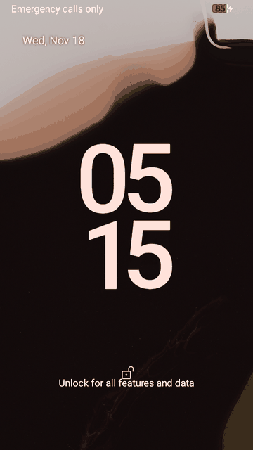
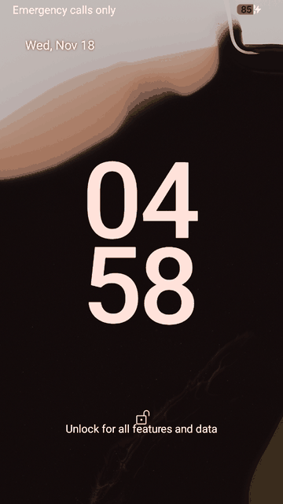

# Android on mvplat

mvplat boots an unmodified Android build: the Cuttlefish phone images that
AOSP's continuous integration publishes, riscv64
(`aosp_cf_riscv64_phone-userdebug`, kernel 6.19) and AArch64
(`aosp_cf_arm64_only_phone-userdebug`, GKI kernel 6.12), both checked with
build 16968706. Nothing in the image is changed:
the disk holds the build's own partitions, the kernel and ramdisks are the
build's own, and what a bootloader would add (the bootconfig) is made by a
script.

## What you need

From the build's artifacts:

- `boot.img`, `init_boot.img`, `vendor_boot.img`, `vbmeta.img`,
  `vbmeta_system.img`, `vbmeta_system_dlkm.img`, `vbmeta_vendor_dlkm.img`,
  `super.img`, `userdata.img` (in the `*-img-*.zip` and the target files);
- for riscv64 only, OpenSBI's `opensbi-riscv64-generic-fw_dynamic.bin` from the host package
  (`cvd-host_package.tar.gz`, under `bootloader/` or `host/`). Any OpenSBI
  1.x `fw_dynamic` works; set `MVPLAT_SBI` to use another.

Put them in one directory, then:

```sh
tests/vplat/android/run.sh IMAGES WORK -max-cycles 300000000000
```

`WORK` gets:

| File | What it is |
|---|---|
| `android.disk` | a GPT disk (sparse, 16 GiB apparent, about 1.4 GiB used) with the partitions Cuttlefish's composite disk has: `misc`, `frp`, `boot_a`, `init_boot_a`, `vendor_boot_a`, the `vbmeta*_a`, `super`, `metadata`, `userdata` (`mkdisk.py`; sparse images are expanded) |
| `android.initrd` | vendor ramdisk + generic ramdisk + bootconfig trailer, as a boot image v4 bootloader would load them (`mkinitrd.py`) |
| `kernel` | the kernel `Image` out of `boot.img` |
| `android.json` or `android-arm64.json` | the platform (`run.sh` picks it from the kernel in `boot.img`): 4 GiB, 16550 UART, goldfish RTC, a PCIe host with virtio-blk (the disk), virtio-rng, virtio-gpu (720 x 1280) and 20 virtio-console ports (`/dev/hvc0` to `hvc19`) |
| `cf/` | the host end of the console ports (`cfhost.py`) and what the guest wrote to each (`cf/hvc2.log` is logcat) |
| `console.log` | the serial console |
| `screen.ppm` | the display when the run ends |

Extra arguments go to mvplat: `-max-cycles`, `-input-at S:TEXT` to type at
the shell at a simulated time, `-harts N` (or `HARTS=N`, default 4). The disk and
initrd are kept between runs; delete them to remake them.

`mkinitrd.py OUT - - key=value...` rewrites only the bootconfig of an
existing initrd, for trying a property.

## The board

Android's riscv64 kernels have no virtio-mmio driver built in, so the virtio
devices sit behind the `pcie` host (ECAM at 0x30000000) and the disk is found
by its PCI path (`androidboot.boot_devices`). The PLIC has 95 sources, as
QEMU's `virt` board: Linux's `sifive-plic` driver writes past its saved
enable words when the count is a multiple of 32.

What the bootconfig sets, besides the vendor_boot image's own entries:

| Entries | Why |
|---|---|
| `slot_suffix=_a`, `force_normal_boot=1`, `verifiedbootstate=orange` | what a bootloader passes (no AVB check is made) |
| `serialconsole=1`, `console=ttyS0` | a shell on the UART |
| `selinux=permissive` | Cuttlefish's default for userdebug |
| `boot_devices`, `fstab_suffix=cf.f2fs.hctr2` | the disk and the fstab for this build's f2fs userdata |
| `vendor.apex.*` gatekeeper and keymint `nonsecure` | no secure world |
| `hardware.gralloc=minigbm`, `hardware.hwcomposer=ranchu`, `hwcomposer.mode=guest`, `display_finder_mode=drm`, `egl=angle`, `vulkan=pastel` | software rendering on the virtio-gpu DRM device |
| `hw_timeout_multiplier=20` | a simulated CPU is slower than a phone: the framework's watchdogs wait 20 times longer |
| `vsock_lights_port=6900` | the lights HAL listens on a vsock port; without one it stops, and `system_server` waits for it until its watchdog restarts it |
| `openthread_node_id=1` | the Thread network HAL's simulated radio; without it the HAL aborts |

## The host side

A Cuttlefish guest's emulated HALs talk to programs on the host over
virtio-console ports, numbered in the order the devices are found. mvplat
connects each port to a Unix socket (`"socket"` in the platform file) and
`cfhost.py`, which `run.sh` starts first, listens on them. It answers what
the boot waits for and logs the rest:

| Port | HAL | What `cfhost.py` does |
|---|---|---|
| `hvc18` | sensors (control) | answers `list-sensors` with no sensors, so `SensorService` starts instead of waiting |
| `hvc10` | OEM lock | keeps the four lock fields in memory and answers reads and writes |
| `hvc2` | logcat | written to `cf/hvc2.log` |

The radio (RIL), Bluetooth and UWB HALs need host programs `cfhost.py` does
not have, so they crash and are restarted. A service in an APEX that crashes
4 times before the boot completes makes apexd roll back and reboot
(`reboot: Restarting system with command 'apexd-failed'`), so `run.sh` types a
loop at the shell every 25 simulated seconds from 400 s to 2000 s that stops
the services being restarted (`STOP_LOOP=0` leaves them).

## How far it gets

With `-harts 4 -mt` mvplat runs at 130 to 225 million instructions per
second; the boot below took 1.8 hours.

| Simulated time | Stage |
|---|---|
| 0.5 s | OpenSBI, then the kernel |
| 17 s | first-stage init; the `super` partitions mapped through device-mapper, `system` verified (dm-verity) |
| 45 s | second-stage init, SELinux policy, apexd |
| 185 s | the serial shell (`console:/ $`) |
| 330 s | `/data` (f2fs) mounted, `odsign` |
| 520 s | `surfaceflinger` and the HWC3 composer up |
| 600 s | boot animation on screen |
| 745 s | `system_server` starts its services |
| 1570 s | `sys.boot_completed=1`: SystemUI and the launcher, the lock screen |

The boot animation as mvplat's `virtio-gpu` shows it, `screen.ppm` at 3000 s:


The lock screen once the boot has completed, `screen.ppm` at 2700 s:



Not yet:

- The radio, Bluetooth and UWB host programs (the HALs are stopped, above).
- One 4-hart run in five stopped with a kernel oops at 637 s; being looked at.
- No `adb` over the network (the virtio-net `user` back end has no NAT), no
  touch or keyboard input device, no audio.
- 3D: only CPU rendering (ANGLE on SwiftShader), no virgl.

## AArch64

`run.sh` sees an arm64 kernel in `boot.img` and boots it on mvplat's arm
board instead (`android-arm64.json`): the Armv8-A cores with the Armv8.1
atomics and CRC32, a GICv3, the PL011 UART as the console (`ttyAMA0`), the
goldfish RTC, and the same PCIe host and virtio devices as riscv64, with its
ECAM at 0x3f000000 and 4 GiB of RAM at 0x40000000. The kernel is started
directly at EL1 with PSCI firmware in mvplat (no bootloader, no OpenSBI);
the bootconfig differs only in `console=ttyAMA0` and the disk's PCI path
(`3f000000.pcie`). The host side and the service loop are the same.

With `-harts 4 -mt` the boot reached `sys.boot_completed=1` in 42 minutes of
host time (on a 2-core host; 1000 simulated seconds took 63 minutes):

| Simulated time | Stage |
|---|---|
| 0 s | the kernel, at EL1 |
| 5 s | first-stage init; `super` mapped, `system` verified |
| 11 s | second-stage init |
| 35 s | the serial shell (`console:/ $`) |
| 41 s | `/data` (f2fs, metadata encryption) |
| 135 s | `zygote` |
| 153 s | `surfaceflinger` |
| 205 s | boot animation |
| 267 s | `system_server` starts its services |
| 600 s | `sys.boot_completed=1` |

The lock screen, `screen.ppm` at 1000 s (a second run, which completed the
boot at 592 s):



As on riscv64, the radio, Bluetooth and UWB HALs crash for want of their
host programs; nothing else does.
